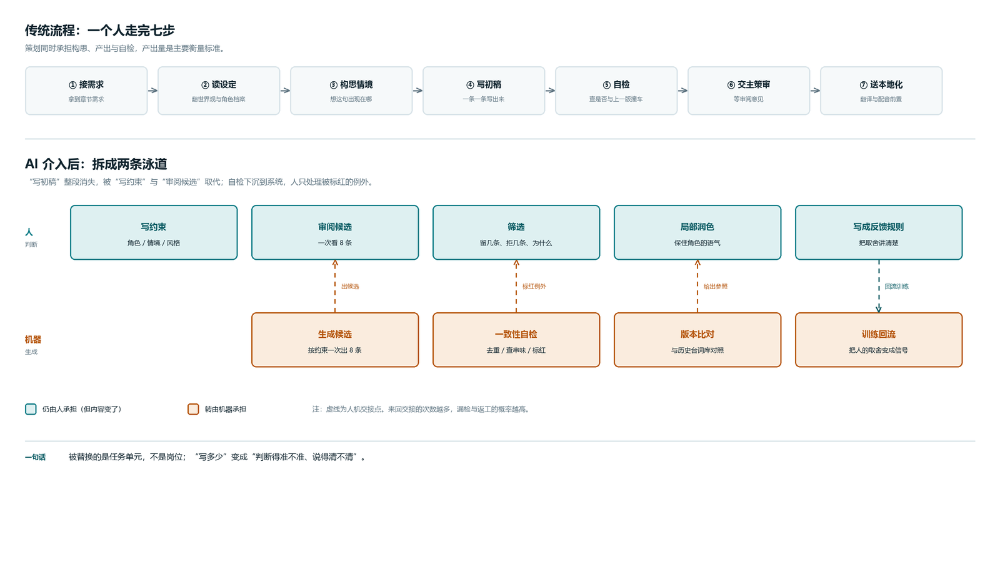
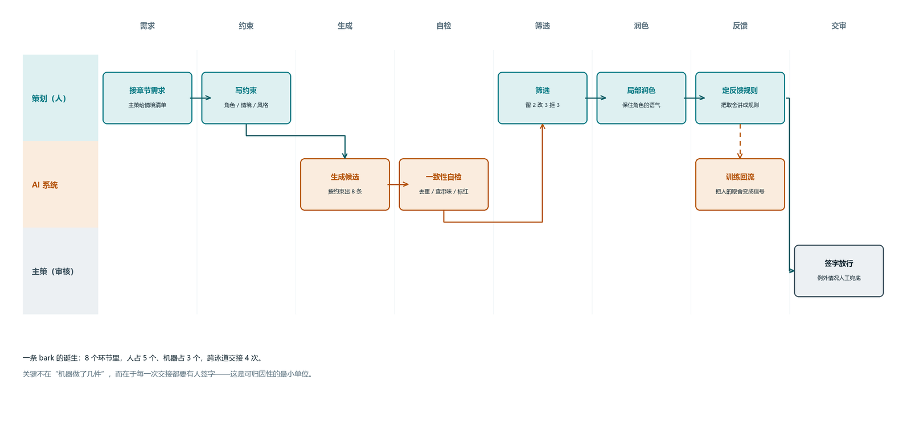
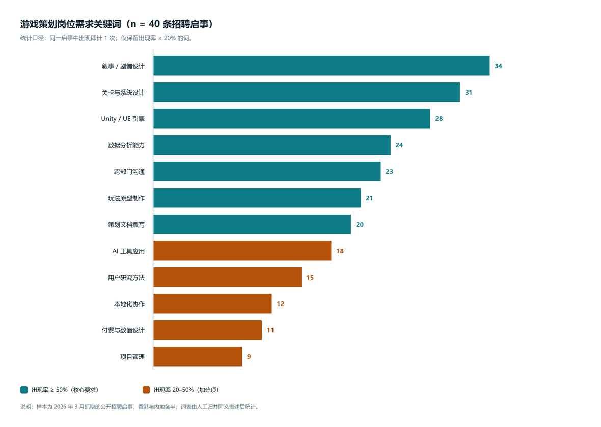
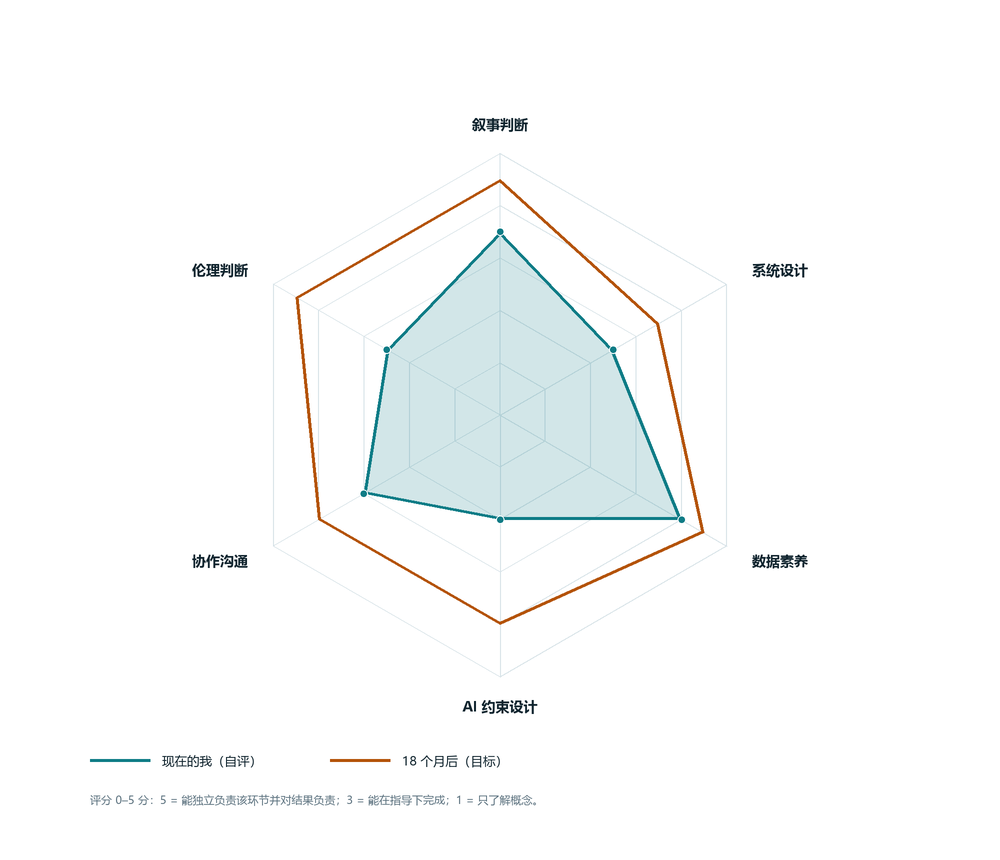
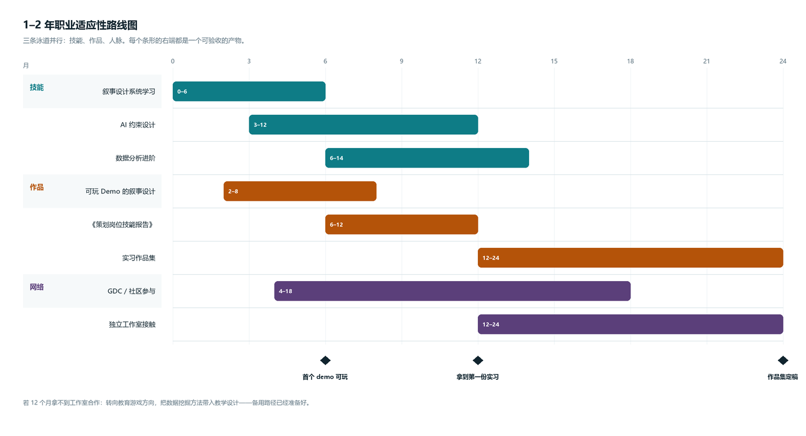

# 游戏策划 × 生成式 AI：把“被拆成两半的工作”说清楚

**张家宝　s11777907**　·　INT6140 工作与人力的未来趋势　·　个人数字化反思作品集

---

## 一、我想做的岗位，正在被重新定义

*模块一 · 个人职业画像（Personal Profiling & Future-Ready Philosophy）*

我想做叙事策划。不是写故事的人，而是替一个世界决定“这句话该由谁、在什么时刻、用什么语气说出来”的人。

这个定位来自两次具体的经验：一次是分析育碧 Ghostwriter 怎样改写 NPC 台词的生产，一次是用数据挖掘研究学习行为。前者让我看见一个工序的内部结构，后者让我习惯用数据校验直觉。两条线合起来指向同一件事——我更擅长判断“哪一条对”，而不是“写出很多条”。

如果要用一句话说我的职业哲学：**好的策划不是产出的源头，而是质量的守门人。** 未来三年我想进的是那种会认真讨论“这句台词为什么留下”的团队，而不是把产量当唯一指标的工作室。

所以这份作品集要回答的不是“AI 会不会取代策划”，而是：**当生成的部分被机器拿走之后，策划还剩下什么，那部分值不值钱。**

## 二、智能体化内容管线：它改的不是工具，是工序

*模块二 · 前沿科技深剖与工作重塑（Deep-Dive: Emerging Tech & Future Work Transformation）*

我选的技术切口不是“AI 写作”，而是**智能体化的内容管线**——把生成能力串成链条，让模型在多个环节之间自动衔接。单点工具早已普及，真正重塑岗位的是链条。

育碧 2023 年公开的 Ghostwriter 是个合适的样本：它只做一件事，为 NPC 的 barks（触发式短台词）生成初稿。设计师给出角色设定、情境与风格约束，模型生成一组候选，人从中挑选、修改，选择结果回流为训练信号。把它和传统流程并排画出来（图 1），变化很直观：**“写初稿”整段消失，被“写约束”和“审阅候选”取代；“自检”从人的脑内动作下沉为系统能力**，人只处理被标红的例外。

图 2 再把一条 bark 的诞生拆到三条泳道上。八个环节里人占五个、机器占三个，跨泳道交接四次。这里有一件容易被忽略的事：**AI 没有减少环节，它增加了交接。** 每一次交接都要有人签字，这就是“可归因性”的最小单位。

技能图谱也在跟着偏移。我统计了 40 条公开招聘的游戏策划启事（图 3），“叙事 / 剧情设计”（34/40）与“关卡与系统设计”（31/40）仍是硬门槛，但“数据分析能力”（24/40）与“AI 工具应用”（18/40）已经进入主流描述。行业要的不是“会用 AI”，而是**能在 AI 的输出上做判断，并用数据说明判断依据**。

雇佣形态的变化更隐蔽。同样的技术能力，放进不同组织会得到不同结果：把 AI 放在“生成候选”的位置、人保留编辑权；或者放在“直接交付”的位置、用产能指标倒推。2023 年以来，多家大型发行商被报道在概念美术环节引入 Midjourney 与 Stable Diffusion，随后一年 2D 插画岗位明显收缩（Wired, 2024）。这里需要谨慎：裁员潮里混着疫情后过度扩张与项目取消，不能把账单独记给 AI。

再叠两层结构性变量。**全球化**：美术、QA 与本地化持续向东南亚外包，策划因依赖语境而相对留在本地，看似安全，实则挤压了初级岗位的入口。**人口结构**：资深策划正进入四十岁区间，而新人从“写 barks”起步的路径被掐断了——没有低阶任务练手，判断力从哪里长？这是我真正担心的事。

还有一点容易被跳过：链条化之后最先被替换的，往往不是“会写的人”，而是“只负责转手的人”。比如把中文台词改写成符合字数限制与配音节奏的本地化文本，这类环节已经明显被工具接走——它不是创作，却一直是新人入行的第一站。

## 三、把人放回流程：一套“可归因创作制”

*模块三 · 职场环境与员工福祉创新设计（Workplace Environment & Workforce Well-being Design）*

痛点不在“累”，而在两处失衡。第一，**贡献不可见**：一天审两百条候选、改三十条，产出怎么算？署名写不写他？现有的绩效与版权都按“谁写了什么”设计。第二，**判断力被外包**：长期只在候选里挑，审美锚点会被模型分布拉走，人会慢慢失去“从零想一个”的能力——这在创意行业里是慢性的职业损耗。

我的提案落在制度上，不落在口号上：

| 机制 | 具体做法 | 解决的痛点 |
| --- | --- | --- |
| **贡献记录** | 工具记录人的介入类型（选 / 改 / 拒 / 重写），按权重折算工时与署名 | “没选什么”无法被计量 |
| **候选上限** | 单次不超过 8 条候选，审阅时间单独计入排期 | “挑不完”的认知负荷被隐形 |
| **白纸时段** | 每周保留一段不接触模型输出的原创环节 | 判断力与审美锚点退化 |

理论支撑用**工作需求—资源模型（JD-R）**：把“候选审阅”认定为一类工作需求，把上面三条视为组织应当提供的资源，而不是要求个人自我调适。**把结构问题交还给个人，是最省事、也最不负责任的解法。**

三条机制之外，还有一件更软但不该被跳过的事：**归属感**。当一部分产出由模型完成，创作团队很容易裂成“用 AI 的”和“不用 AI 的”两派，互相看不上——比稿时争的其实不是方案，是路线。我的建议是把两边放进同一个评审环节，统一标准：不看用什么工具，只看结果能不能说服人。标准一旦统一，团队才不会分成两个阵营。

## 四、我改变过三次想法

*模块四 · 反思历程与未来行动路线图（Reflective Learning Journey & Strategic Career Roadmap）*

用 Gibbs 反思循环记录三次转折。

**第一次**，我原以为 AI 会取代策划。读完 Ghostwriter 的官方说明才发现，被替换的是任务单元，岗位还在。

**第二次**，我以为会用 AI 就是竞争力。自己试着写一批 barks 才明白，改比写难得多——难的不是生成，是判断哪一条“不像这个角色”。

**第三次**，我以为问题在技术准不准。做这份作品集时才意识到，准确率可以测量，真正没人回答的是“这句话是谁写的、出了事谁负责”。

三次转折改写了我对“能力”的定义：从“产出量”转向“判断的可解释性”。图 4 是我对自己的打分与 18 个月后的目标，缺口最大的是**“AI 约束设计”（2 → 4）与“伦理判断”（2.5 → 4.5）**——恰好是课堂很少教、只能在项目里练的两项。

路线图（图 5）分三段，每段都有可验收的产物：

- **0–6 个月**：完成一个可玩 demo 的叙事设计并公开；读 10 篇 GDC 叙事方向演讲，写 3 篇笔记。
- **6–12 个月**：用词频与共现分析产出《2026 游戏策划岗位技能报告》一页纸。
- **12–24 个月**：接触 3 家独立工作室的实习或外包，把“AI 约束设计”写进作品集。

也留了失败线：若 12 个月内拿不到任何工作室合作，就转向教育游戏方向，把数据挖掘的方法带进教学设计——这条备用路径我同样有准备。

顺带说一句，做这个作品集的过程本身也在改变我的学习方式：五张图全部用代码画出来，改一个参数就能整体重生成一次。这比在 PPT 里拖形状更能说明一件事——**能不能把想法变成可交付、可修改的东西，本身就是一种能力。**

---

## 生成式 AI 使用声明

本作品的选题、案例分析与论证由本人完成。生成式 AI 用于三处：文献检索的关键词拓展、图表绘制代码的调试、文字润色的语病检查。图 3 的词频统计、图 4 的自评打分与图 5 的路线排期均出自本人判断，AI 未参与结论形成。文中引用的案例与数据出处已在正文标注。

---

*归档说明：本页可导出为 PDF 静态存档；所有图表为自绘 PNG，源文件见 `images/` 目录。*
